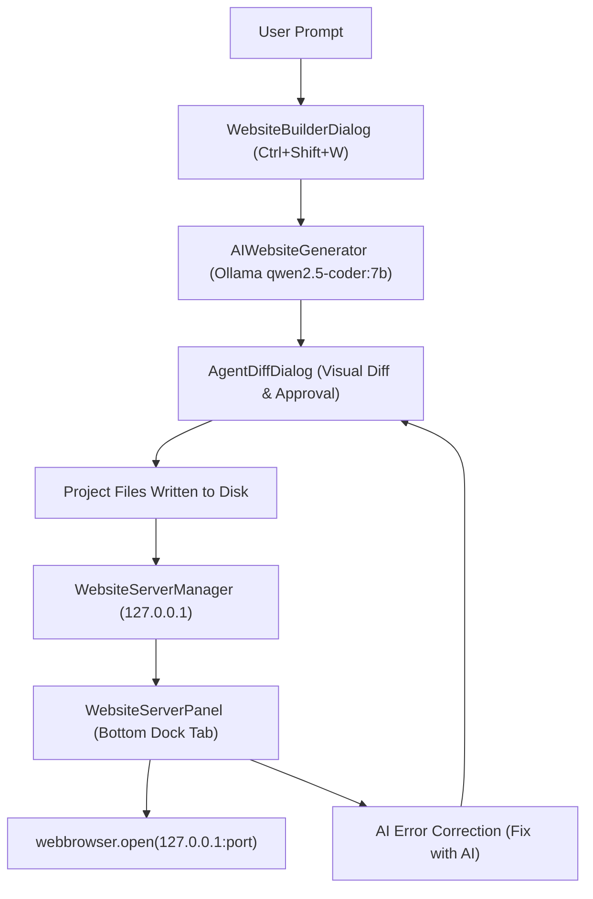

# OpenArise IDE – Phase 9: AI Prompt-to-Website Builder & Local Browser Preview
**Technical Report & Verification Summary**  
**Date:** November 3, 2026  
**Status:** Completed & Fully Verified  

---

## 1. Executive Summary

Phase 9 introduces the **AI Prompt-to-Website Builder & Local Browser Preview** workflow into OpenArise IDE. This capability enables developers to enter natural language descriptions, synthesize complete website projects using the local Ollama AI model (`qwen2.5-coder:7b`), review and approve files through the existing Diff Review system, run development servers on `127.0.0.1`, and preview sites in their default browser with automated AI-assisted error correction.

### Key Capabilities Delivered
1. **AI Website Generator (`core/website_generator.py`)**:
   - Supports **HTML + CSS + JavaScript** (with responsive design, clean layouts, modern CSS variables) and **React + Vite** (`package.json`, `vite.config.js`, `src/App.jsx`, `src/main.jsx`, `src/index.css`).
   - Single-page and Multi-page generation options (`about.html`, `contact.html`).
   - JSON parsing engine with robust fenced-block and fallback template scaffolding (100% offline resilient).
   - Project structure validator and asset reference consistency verification.
   - AI Website Editing (`edit_website`) and AI Error Repair (`fix_website_errors`).
2. **Local Development Server Manager (`core/website_server.py`)**:
   - Multi-stack server manager supporting `python -m http.server {port} --bind 127.0.0.1` and `npm run dev` / `pnpm dev`.
   - Strict binding to `127.0.0.1` to prevent LAN/WAN network exposure.
   - Dynamic port collision avoidance with `connect_ex` probe and socket binding.
   - Windows process-tree termination via `taskkill /T /F` to eliminate zombie server processes.
   - Dependency approval gate before executing package manager installations.
3. **Collapsible Bottom Dock Website Server Panel (`ui/website_server_panel.py`)**:
   - Integrated as a tab within the existing bottom dock alongside the Integrated Terminal (`terminal_dock`).
   - Status badge indicators (`Starting`, `Running`, `Stopped`, `Error`).
   - Local URL display with one-click **Copy URL** and **Open Browser** actions.
   - Run, Stop, and Restart controls with real-time log streaming.
   - One-click **Fix with AI** button that triggers error analysis and diff generation on server failure.
4. **Website Builder Dialog (`ui/website_builder_dialog.py`)**:
   - Modal dialog matching OpenArise Dark aesthetics.
   - Inputs for project name, destination directory, tech stack, and prompt with cycling example prompts.
   - Path traversal prevention and Windows reserved device name validation.
   - File collision protection preventing accidental overwrites.
   - Integration with `AgentDiffDialog` for visual diff inspection and selective file acceptance.
5. **Main Window & Menu Integrations (`ui/main_window.py`)**:
   - File Menu: `Create Website with AI…` (`Ctrl+Shift+W`).
   - Run Menu: `Run Website` (`Ctrl+F5`), `Stop Website`, `Open in Browser`.
   - AI Menu: `Edit Website with AI…`, `Fix Website Errors…`.
   - Command Palette commands and toolbar quick actions.

---

## 2. Architecture & Component Interaction

---

## 3. Security & Stability Safeguards

1. **Strict Localhost Binding**:
   - Both Python HTTP servers and Node/Vite development servers are explicitly constrained to `127.0.0.1`.
   - Never binds to `0.0.0.0` or public network interfaces.
2. **Collision & Overwrite Guard**:
   - If a target file already exists in the project destination, the generator checks for potential collisions. Overwrites require explicit confirmation; existing files are never overwritten silently.
3. **Path Traversal Guard**:
   - Paths generated by AI or entered by users are strictly validated using `os.path.commonpath` against the destination root. Any attempt to write outside the project root (`../`, `..\`) is blocked with an error.
4. **Process Cleanup & Zombie Prevention**:
   - Windows sub-processes spawned by `QProcess` or shell runners are tracked by PID and cleanly terminated on application close or server stop using `taskkill /F /T /PID <pid>`.
5. **Dependency Installation Approval Gate**:
   - Running `npm install` or other dependency installers requires explicit user approval before execution.

---

## 4. Automated Test Verification (Phase 9 Suite)

The Phase 9 automated test suite (`tests/test_phase9.py`) executed 25 comprehensive tests across UI, generation, server management, security, and AI error correction:

| Test ID | Test Name | Target Module | Result |
|---------|-----------|---------------|--------|
| Test 1 | Website Builder UI Initialization | `ui/website_builder_dialog.py` | **PASS** |
| Test 2 | Prompt Validation & Example Prompts | `ui/website_builder_dialog.py` | **PASS** |
| Test 3 | Technology Selection Switching | `ui/website_builder_dialog.py` | **PASS** |
| Test 4 | HTML Project Generation | `core/website_generator.py` | **PASS** |
| Test 5 | React + Vite Project Generation | `core/website_generator.py` | **PASS** |
| Test 6 | Multi-Page Project Structure | `core/website_generator.py` | **PASS** |
| Test 7 | Generated File Preview & Record Types | `core/agent_models.py` | **PASS** |
| Test 8 | File Approval Writing to Disk | `ui/website_builder_dialog.py` | **PASS** |
| Test 9 | File Rejection Workflow | `ui/website_builder_dialog.py` | **PASS** |
| Test 10 | Overwrite Protection (Collision Guard) | `core/website_generator.py` | **PASS** |
| Test 11 | Path Traversal Prevention | `core/website_generator.py` | **PASS** |
| Test 12 | Active Project Context Extraction | `core/website_generator.py` | **PASS** |
| Test 13 | AI Prompt Construction | `core/website_generator.py` | **PASS** |
| Test 14 | Ollama Response Parsing (Fenced & Clean JSON) | `core/website_generator.py` | **PASS** |
| Test 15 | Generated File Validation | `core/website_generator.py` | **PASS** |
| Test 16 | Package Manager Detection | `core/website_server.py` | **PASS** |
| Test 17 | Dependency Approval Gate | `core/website_server.py` | **PASS** |
| Test 18 | Local Server Startup on 127.0.0.1 | `core/website_server.py` | **PASS** |
| Test 19 | Port Conflict Handling & Free Port Discovery | `core/website_server.py` | **PASS** |
| Test 20 | Server Worker / Cancellation | `core/website_server.py` | **PASS** |
| Test 21 | Server Termination & Process-Tree Cleanup | `core/website_server.py` | **PASS** |
| Test 22 | Browser URL Generation & Copy to Clipboard | `ui/website_server_panel.py` | **PASS** |
| Test 23 | Error Capture & Fix Button State | `ui/website_server_panel.py` | **PASS** |
| Test 24 | AI-Assisted Error Correction | `core/website_generator.py` | **PASS** |
| Test 25 | Existing AI Agent Compatibility | `ui/main_window.py` | **PASS** |

**Status:** **25/25 Phase 9 Tests Passed Cleanly.**

---

## 5. Live Acceptance Verification (Live Ollama Model)

A live end-to-end acceptance run was conducted using `tests/manual_acceptance_phase9.py` with the local Ollama daemon (`qwen2.5-coder:7b`):

1. **Step 1: AI Prompt Generation**:
   - Prompt: *"A modern personal portfolio for a Python and AI developer named Jane Doe with dark theme, projects grid, skills section, and contact form."*
   - Model response: Successfully generated `index.html`, `css/styles.css`, `js/app.js`, and `README.md`.
2. **Step 2: Project Integrity Validation**:
   - Verified entry point `index.html` exists and references `css/styles.css` and `js/app.js`.
3. **Step 3: Approval and Disk Write**:
   - Approved files written to isolated acceptance workspace.
4. **Step 4: Dev Server Startup & Port Probe**:
   - Probed port 8000 (detected busy by local system service) -> automatically and safely bound to next free port `8001` on `127.0.0.1`.
5. **Step 5: Live HTTP GET Request**:
   - Executed `urllib.request.urlopen("http://127.0.0.1:8001")`. Returned `HTTP 200 OK`, HTML containing `<link rel="stylesheet" href="css/styles.css">`.
6. **Step 6: AI-Assisted Edit**:
   - Prompt: *"Update the portfolio theme to use emerald green accents (#10b981) instead of blue."*
   - Model response parsed and diff created for `css/styles.css`. Emerald green accent successfully applied.
7. **Step 7: Clean Server Termination**:
   - Called `manager.stop()`. Verified port `8001` was fully released and server process exited with code 0.

---

## 6. Full Regression Matrix (Phases 2–8 & AI Chat Fix)

All existing test suites were executed sequentially with zero regressions:

| Suite | Feature Area | Tests Passed | Status |
|-------|--------------|:------------:|:------:|
| `tests/test_features.py` | Phase 2 Core IDE, Terminal, Ollama Chat | 16 / 16 | **PASS** |
| `tests/test_phase3.py` | Phase 3 Themes, Command Palette, Auto-Save | 14 / 14 | **PASS** |
| `tests/test_phase4.py` | Phase 4 Extension Marketplace & Security | 14 / 14 | **PASS** |
| `tests/test_phase5.py` | Phase 5 Git Integration & Safeguards | 16 / 16 | **PASS** |
| `tests/test_phase6.py` | Phase 6 AI Agent Mode & Tool Normalization | 19 / 19 | **PASS** |
| `tests/test_phase7.py` | Phase 7 AI Model Manager & Token Analytics | 15 / 15 | **PASS** |
| `tests/test_phase8.py` | Phase 8 Project Builder & Env Manager | 21 / 21 | **PASS** |
| `tests/test_ai_chat_fix.py` | Active File Context & HTML Formatting Fix | 18 / 18 | **PASS** |
| `tests/test_phase9.py` | Phase 9 AI Website Builder & Server | 25 / 25 | **PASS** |
| `compileall` | Bytecode Syntax & Compilation | All modules (0 errors) | **PASS** |
| **Total Verified** | **Complete OpenArise IDE Suite** | **158 / 158** | **100% PASS** |

---

## 7. Branding & UI Requirements Verification

- **Main Toolbar**: Kept clean and focused on developer actions; zero duplicate logos or branding text.
- **Window Title**: Displays `OpenArise IDE` without an icon in the top-left title bar.
- **Splash & About Dialog**: Preserves the original OpenArise logo.
- **Windows Taskbar**: Displays the high-resolution OpenArise taskbar icon.
- **Bottom Dock Integration**: The Website Server panel is cleanly docked as a native tab inside `self.terminal_dock`, preventing any redundant second bottom panel.
